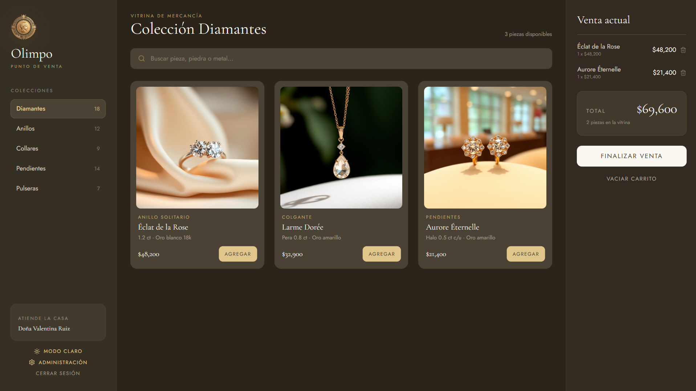
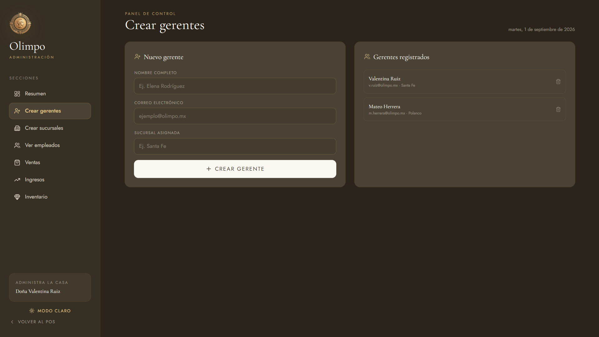
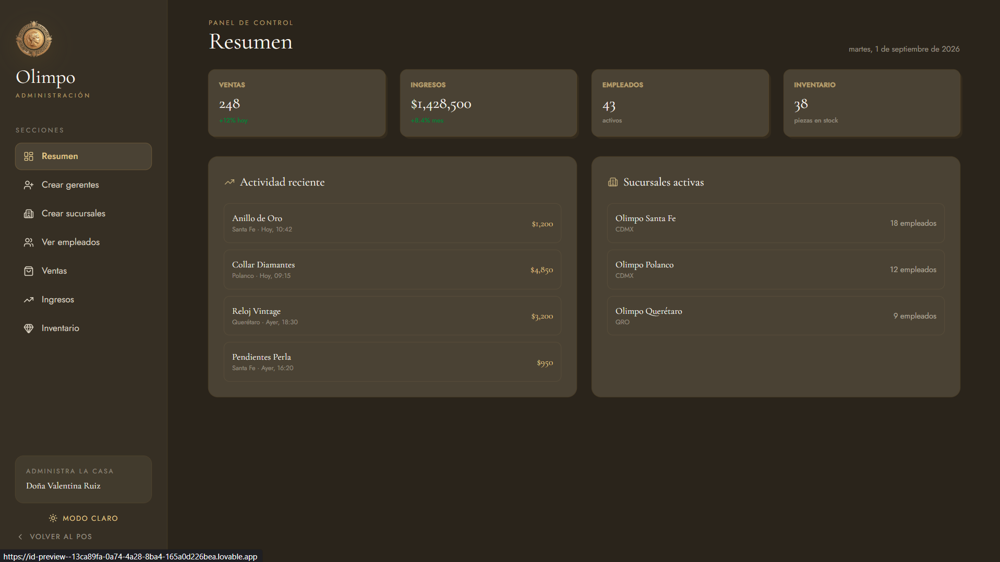

<div align="center">


# POS Olimpo

**Punto de venta e inventarios para joyerías**

Proyecto Integrador · Tercer semestre · Ingeniería de Software

[](https://angular.dev)
[](https://www.typescriptlang.org)
[](https://nodejs.org)
[](https://www.postgresql.org)


</div>

---

## Acerca del proyecto

POS Olimpo es una aplicación web para administrar las operaciones de una joyería. Está pensada para artículos de alto valor que pueden variar por pieza, metal, quilataje y peso. Reúne ventas, inventario y administración del negocio en un mismo sistema.

El acceso se organiza por roles —Administrador, Gerente y Cajero— y por sucursal, para que cada usuario trabaje con las funciones que necesita.

## Funciones principales

| Área | Funciones |
|---|---|
| **Punto de venta** | Registro de ventas, resumen de compra, selección de métodos de pago y emisión del ticket. |
| **Caja** | Apertura y cierre de turnos, captura de efectivo inicial, registro de ingresos y egresos, y consulta del historial. |
| **Cobros** | Pagos en efectivo, tarjeta de débito o crédito y transferencia; permite combinar métodos en una misma venta. Para tarjeta se registra la autorización del voucher, no el número de tarjeta. |
| **Productos e inventario** | Catálogo de joyas con características del metal, quilataje y peso; consulta de existencias por sucursal. |
| **Apartados** | Registro y seguimiento de anticipos y abonos. |
| **Sucursales y personal** | Administración de sucursales, empleados, roles y permisos. |
| **Proveedores** | Alta y consulta de contactos y datos comerciales. |
| **Precio del metal** | Consulta y administración de los precios usados por el sistema. |
| **Datos bancarios** | Registro de cuentas por sucursal y consulta filtrada para el Administrador. |
| **Datos de facturación** | Configuración de los datos del emisor que aparecen en la vista de factura. |
| **Documentos de muestra** | Descarga de documentos de factura en XML y PDF para demostraciones escolares. **No son CFDI ni tienen validez fiscal.** |
| **Idioma y preferencias** | Configuración de opciones de la aplicación y uso en español o inglés. |

Las opciones disponibles dependen del rol del usuario. El servidor también valida los permisos antes de realizar operaciones.

## Capturas

<div align="center">

**Inicio de sesión**


<br>

**Vitrina de mercancía**


<br>

**Panel de administración**


<br>



</div>

---

## Módulos

| Módulo | Descripción |
|---|---|
| **Acceso** | Inicio de sesión y control por rol |
| **Productos** | Catálogo de piezas con peso, metal y quilataje |
| **Caja** | Registro de ventas |
| **Inventario** | Existencias y alertas de stock |
| **Apartados** | Anticipos y calendario de abonos |
| **Reportes** | Reportes PDF por rango de fechas con resultados por empleado, métodos de pago y productos; se envían al correo del Administrador o Gerente que los genera |

---

## Tecnologías

| Capa | Tecnologías |
|---|---|
| **Frontend** | Angular 22, TypeScript, HTML y CSS |
| **Backend** | Node.js, Express y TypeScript |
| **Base de datos** | PostgreSQL |
| **Comunicación** | API REST y JSON |
| **Control de versiones** | Git y GitHub |

## Estructura del repositorio

```text
client/          Aplicación web Angular
server/          API REST en Express y TypeScript
server/scripts/  Scripts de migración y configuración de la base de datos
docs/img/        Logotipo y capturas para este README
```

## Requisitos

- Node.js y npm
- PostgreSQL
- El esquema inicial de la base de datos del proyecto

La base debe llamarse `pos_olimpo`. El archivo base `DB_v4.sql` se comparte por separado y debe importarse antes de ejecutar las migraciones de este repositorio.

## Instalación y ejecución

### 1. Descargar el proyecto

```bash
git clone https://github.com/CharlieTech07/PUNTO-DE-VENTA-JOYERIA.git
cd PUNTO-DE-VENTA-JOYERIA
```

### 2. Preparar PostgreSQL

1. Crea la base de datos `pos_olimpo`.
2. Importa el esquema inicial `DB_v4.sql` proporcionado por el equipo.
3. En pgAdmin, abre **Query Tool** conectado a `pos_olimpo` y ejecuta las migraciones necesarias de `server/scripts/`:
   - `migracion-nombre-usuario.sql`
   - `migracion-detalle-ventas.sql`
   - `migracion-facturas.sql`
   - `migracion-aceptacion-terminos.sql`
   - `migracion-datos-bancarios-fiscales.sql`
   - `migracion-pagos.sql` (después de `migracion-facturas.sql`)
   - `migracion-caja.sql` (después de `migracion-pagos.sql`)

Para una base nueva, configura primero un usuario administrador. `crear-usuarios-iniciales.sql` puede servir como punto de partida: edita sus valores de ejemplo antes de ejecutarlo. No lo ejecutes si ya existen los usuarios iniciales.

Opcionalmente, `datos-demostracion-bancarios.sql` agrega datos ficticios para una demostración. No uses esos datos para transferencias ni como información fiscal real.

### 3. Configurar el servidor

Crea el archivo `server/.env` y configura la conexión a PostgreSQL y una clave secreta para las sesiones. Por ejemplo:

```env
DB_HOST=localhost
DB_PORT=5432
DB_USER=postgres
DB_PASSWORD=tu_contraseña_de_postgres
DB_NAME=pos_olimpo
JWT_SECRET=escribe_aqui_una_clave_larga_y_privada
```

El correo de bienvenida es opcional y requiere `CORREO_USUARIO` y `CORREO_CONTRASENA_APP`. Configura `APP_URL` con la dirección donde ejecutas Angular si usarás los enlaces enviados por correo. El archivo `.env` contiene datos privados y no debe subirse a GitHub.

En una terminal:

```bash
cd server
npm install
npm run dev
```

El servidor API inicia en `http://localhost:3000`.

### 4. Iniciar la aplicación web

Abre otra terminal:

```bash
cd client
npm install
npm start
```

Abre `http://localhost:4200`. Durante el desarrollo, Angular reenvía las solicitudes `/api` al servidor en el puerto `3000` mediante `client/proxy.conf.js`.

## Documentos de factura

La aplicación permite capturar datos del receptor y mostrar una factura de ejemplo. Los archivos descargables XML y PDF se generan para una demostración escolar; **no son CFDI, no incluyen timbre y no sustituyen una factura fiscal**. Para emitir CFDI válidos se requiere integrar un proveedor autorizado de certificación y configurar datos fiscales reales.

## Metodología

El equipo trabaja con Scrumban: ciclos cortos de trabajo y un tablero Kanban con tareas pendientes, en proceso y finalizadas. Cada integrante desarrolla en su propia rama y los cambios se integran mediante pull requests.

## Equipo de desarrollo · Equipo 5

| Integrante | Rol |
|---|---|
| Carlos Arturo Argüellez Ruiz | Líder de equipo |
| Juan Amador Benítez | Desarrollo |
| Cristian Alexander Escobar Nuñez | Desarrollo |
| Jesús Enrique Ibarra Figueroa | Desarrollo |
| Alan Yakxel Juárez Cano | Desarrollo |

---

<div align="center">

Universidad de Colima · Facultad de Ingeniería Electromecánica
Ingeniería de Software · Grupo 3-E · Manzanillo, Colima

</div>
